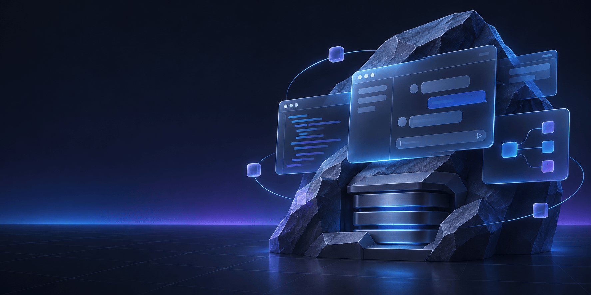

# Skai Desktop

<div align="center">
  
  <h1>Skai Desktop</h1>
  <p><strong>One desktop for everything you want to do with AI.</strong></p>
  <p>Bring your models, projects, and ideas into one workspace—whether you code, create, explore, or just want a capable AI on your own machine.</p>
</div>

<p align="center">
  
</p>

Skai Desktop is built for people who want AI to fit their work, instead of reshaping their work around a single chat box. Start with a question, a codebase, a document, or a creative idea. Choose a model, bring in context, work through the task, and stay in control of the result.

> **Try the 0.1.4 testing release:** [Download from GitHub Releases](https://github.com/WowLolCoolMan/skai-desktop/releases/latest). The Windows release is unsigned; production code signing is deferred while the app is in active development. See [release readiness](docs/operations/RELEASE_READINESS.md) for verified status and remaining limits.

## Why switch to Skai?

If your AI setup is scattered across a chat app, a model launcher, a coding tool, and a folder of creative utilities, Skai is an attempt to bring that work together. It is for developers who want an agent beside their project, hobbyists exploring local models, and creative users moving between ideas and media.

- **Bring your own models.** Connect a supported local runtime and choose which model handles the work. Chat prompts stay on your machine in the current release; Skai does not silently switch to a hosted model.
- **Take an idea through to a result.** Keep project context with the conversation, inspect and edit files, review agent changes, and keep or undo the work.
- **Stay in the loop.** Agent actions are bounded and reviewable, with approvals, cancellation, and undo. Supported project commands use OS isolation and fail closed when Skai cannot establish it.
- **Use AI for more than coding.** Chat, documents, images, audio, personas, local creative tools, and desktop companions share the same app.
- **Help make the bigger idea real.** Skai is early and still has rough edges. Users and contributors can help decide what gets better next.

**The idea:** ask → bring context → work → review → keep or undo.

## What you can do

| Area | Skai Desktop today |
| --- | --- |
| **Chat** | Persistent conversations, local memory, search, folders, tags, split view, attachments, document-grounded turns, queued follow-ups, and conversation export/import. |
| **Coding and projects** | Project-linked chats and tasks, Monaco editor, bounded previews, reviewable file changes, guarded terminal actions, cancellation, undo, and task activity. |
| **Models** | Local runtime discovery, model library, explicit model switching, capability checks, comparisons, and reviewed downloads for supported catalog formats. |
| **Voice and media** | Local speech output, local audio transcription, hands-free controls, image generation/editing, and local video-frame sampling. Microphone dictation depends on the operating system's speech pack. |
| **Marketplace and tools** | Search supported catalogs, review installs, manage installed items, and connect local MCP tools. Support varies by category; the [capability matrix](docs/planning/CAPABILITY_MATRIX.md) lists current boundaries. |
| **Personal workspace** | Themes, keyboard shortcuts, in-app documentation, saved personas, and seven built-in animated companions. |

See the [capability matrix](docs/planning/CAPABILITY_MATRIX.md) for what has been verified and what still has limits.

## What we want to build next

The long-term goal is an AI desktop that can grow with what people want to do: bring their own models, tools, context, and ideas, then move from the first question to a finished result. We are prioritizing useful workflows and trustworthy foundations over feature checklists.

- **Talk to your AI naturally:** improve real-time voice, interruption, local speech, and workflows that combine text, images, audio, and video.
- **Build and create in one flow:** bring project planning, implementation, checks, previews, and change review together, with useful browser and Python tools as they are ready.
- **Get more from local models:** broaden runtime support, improve hardware-aware scheduling, and explore local model training and fine-tuning.
- **Make the workspace yours:** expand reusable personas, voice choices, skills, integrations, and creative workflows while keeping model and tool choices in the user's hands.

These are goals, not release-date promises. Some work is underway; other ideas need design, engineering, and real-world testing. The [future features list](docs/planning/FUTURE_FEATURES.md) tracks proposals, and the [active work queue](docs/planning/TO_DO_NEXT.md) shows near-term work and evidence.

## Help build the AI desktop you want

The best way to back Skai is to try it and tell us what feels useful, confusing, or broken. If you build software, improve a feature or fix a rough edge. If you use AI for something else, show us the workflow you wish your desktop could handle.

- [Try the latest release](https://github.com/WowLolCoolMan/skai-desktop/releases/latest)
- [See current capabilities and gaps](docs/planning/CAPABILITY_MATRIX.md)
- [Find active work](docs/planning/TO_DO_NEXT.md)
- [Read the contributor guide](CONTRIBUTING.md)

## License and reference use

Skai Desktop is published under a modified MIT-style license. The repository
is open for research, evaluation, learning, and independent implementation.

- You may study how Skai works and use its ideas, workflows, and general
  concepts as reference for your own implementation.
- Please do not copy and paste, adapt, or incorporate Skai source code or
  substantial portions of it into another project without written permission.
- Skai names, logos, and other branding are not licensed for reuse or implied
  endorsement.
- Third-party components and earlier versions that were released under MIT or
  another license remain governed by those original terms.

Read the complete [Skai Desktop Modified MIT License](LICENSE),
[contribution terms](CONTRIBUTING.md), and [third-party notices](THIRD_PARTY_NOTICES.md)
before reusing anything from the repository.

## Local-first, with clear boundaries

Chat inference in the shipped release runs through the local model runtime you select. Skai does not send chat prompts to hosted model providers or silently fall back to a cloud model. Skai does not sell model access; you choose and configure your own runtimes.

Some actions connect to their own services—for example, web search, GitHub operations, or catalog and model downloads. Those integrations use the network to perform the action you selected. Optional user-connected cloud and hybrid **chat model** routes are planned, but are not available in the current release. Before those routes ship, the provider gateway must provide explicit routing, protected credentials, clear data disclosure, and an offline-only mode.

## Safer project commands

Coding Agent commands are isolated by the operating system:

- **Windows:** AppContainer isolation limits project commands to the selected project and required read-only runtime paths, with no network access. A Job Object also limits process count and memory. If Windows cannot establish the sandbox, Skai refuses to run the command.
- **Linux:** Bubblewrap isolates project commands with read-only system paths, a writable selected-project directory, a private temporary directory, and separate process, network, IPC, and UTS namespaces. Resource limits use systemd cgroups. If Bubblewrap or required namespaces are unavailable, Skai refuses to run the command.
- **Other platforms:** Coding Agent commands remain disabled until Skai can establish a supported sandbox. Skai does not fall back to unrestricted project commands.
- **Interactive Terminal:** This is a separately user-opened shell and does not use the Coding Agent command sandbox.

See the [capability matrix](docs/planning/CAPABILITY_MATRIX.md) for acceptance evidence and remaining platform gaps.

## Run from source

To build and run Skai from source, install:

- Windows 10 or 11
- Node.js 20 or newer
- .NET 10 SDK
- Ollama, LM Studio, or another supported local model runtime for AI responses (optional for interface work)

```sh
npm run desktop:install
npm run desktop:dev
```

To build the renderer and open the desktop shell:

```sh
npm run desktop:build
npm run open:desktop
```

## Linux desktop notes

Linux x64 packages use a per-user installer and do not require root for installation. Extract the `Skai-Desktop-electron-linux-x64` archive and run `./install.sh`; `./uninstall.sh` removes the app while keeping your data. The current package and update acceptance status is in the [release readiness report](docs/operations/RELEASE_READINESS.md).

Window behavior depends on your desktop environment:

- **Wayland:** Skai uses XWayland by default so companion windows can be positioned. Set `SKAI_OZONE_PLATFORM=wayland` to use native Wayland; the compositor then controls pet placement and dragging.
- **Tiling window managers:** Pets request a floating window. Add a window rule if your manager tiles them.
- **X11 without a compositor:** Transparent companion windows may appear black. Run a compositor such as `picom`, or hide companions from the tray or Settings.
- **System tray:** Closing the window keeps Skai running only when a tray host is available. Without one, closing quits the app.

macOS is not yet covered by the release acceptance matrix, and Coding Agent commands are disabled there.

## Project structure

```text
apps/desktop/              Electron + React desktop app
services/agent-host/       Persistent .NET host and protocol boundary
native/SkaiDesktop.Core/   Shared provider, persistence, workflow, and safety logic
assets/                    Branding and built-in companion assets
docs/                      Guides, plans, release evidence, and research
```

## Documentation

- [Documentation index](docs/README.md) — guides, engineering notes, operations, and research
- [Capability matrix](docs/planning/CAPABILITY_MATRIX.md) — current features and limits
- [To Do Next](docs/planning/TO_DO_NEXT.md) — active contributor work
- [Future features](docs/planning/FUTURE_FEATURES.md) — longer-term proposals
- [Local model library](docs/guides/MODEL_LIBRARY.md) — supported runtimes and model installation
- [Local image generation](docs/guides/LOCAL_IMAGE_GENERATION.md) — setup and acceptance boundaries

## Contributing

Keep changes incremental and verifiable. Preserve the Electron → isolated IPC → .NET Agent Host boundary, keep provider secrets out of the renderer, and include evidence for user-facing changes. Start with [CONTRIBUTING.md](CONTRIBUTING.md).

Contributions are welcome when you have the rights to submit the work and have
documented any third-party source, assets, models, or documentation. See
[CONTRIBUTING.md](CONTRIBUTING.md) for the review process and
[CONTRIBUTOR_LICENSE_AGREEMENT.md](CONTRIBUTOR_LICENSE_AGREEMENT.md) for the
contribution terms.

## Development checks

Run the checks that match your change before opening a pull request:

```sh
npm run check:syntax
npm run check:hygiene
npm run audit:electron-runtime
npm run audit:local-only
npm test
npm run desktop:typecheck
npm run desktop:build
```
