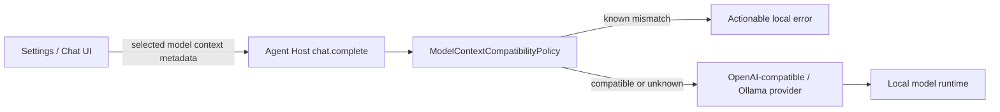

# Model context preflight

## Goal

Make the optional Ollama context-window setting actionable and predictable. When Skai knows the selected model advertises a smaller context than the configured request, the UI should explain the mismatch and the Agent Host must reject the request before it reaches the local runtime. Compatible models and models without discovered context metadata remain usable, so incomplete discovery does not become an accidental hard block.

## Context map

### Files to modify

| File | Purpose | Changes needed |
|---|---|---|
| `native/SkaiDesktop.Core/Services/ModelContextCompatibilityPolicy.cs` | Shared pure validation rule | Add the provider-aware known-mismatch explanation. |
| `services/agent-host/Protocol/AgentHostLoop.cs` | `chat.complete` request boundary | Read optional model metadata, enforce the policy before provider/network work. |
| `apps/desktop/src/features/chat/useChatWorkspace.ts` | Chat, rewrite, retry, and edit requests | Send the selected model's discovered context length with each request. |
| `apps/desktop/src/features/settings/SettingsPage.tsx` | Models & Providers settings | Show a clear warning for a known incompatible configured window. |
| `native/SkaiDesktop.Core.Tests/ModelContextCompatibilityTests.cs` | Core unit coverage | Cover Ollama mismatch, compatible, unknown, and non-Ollama cases. |
| `native/SkaiDesktop.Core.Tests/Program.cs` | Native test entrypoint | Register the new test class. |
| `docs/FUTURE_FEATURES.md` | Feature status | Record that known incompatibilities are guarded; compatible 1M execution remains environment-dependent. |

### Dependencies and reference patterns

| File | Relationship |
|---|---|
| `native/SkaiDesktop.Core/Services/OpenAiCompatibleProvider.cs` | Applies Ollama `num_ctx` to the local request after host validation. |
| `apps/desktop/src/app/useDesktopWorkspace.ts` | Already resolves selected `Model` metadata and passes it into `useChatWorkspace`. |
| `native/SkaiDesktop.Core.Tests/ChatProviderTests.cs` | Existing 1M request-contract coverage. |

## Requirements

- Reject only a known Ollama mismatch: configured context > discovered selected-model context.
- Keep the guard local and before runtime network access.
- Allow runtime default, compatible metadata, unknown metadata, and non-Ollama providers.
- Keep the message actionable and bounded; do not expose secrets or send telemetry.
- Surface the same condition in Models & Providers settings.
- Cover the policy with deterministic native tests and verify frontend/build/smoke checks.

## Integration flow

## Acceptance criteria

1. A discovered 262,144-token model with a configured 1,048,576-token Ollama window shows a warning and `chat.complete` fails before provider network access.
2. A discovered 1,048,576-token model succeeds through the existing provider path.
3. Missing context metadata does not block a request.
4. Native unit tests, typecheck, build, syntax/hygiene checks, future-feature audit, smoke harness, and `git diff --check` pass.
5. Before commit, the branch is fetched and rebased if `origin/main` advanced; the finished commit is pushed to `main`.
